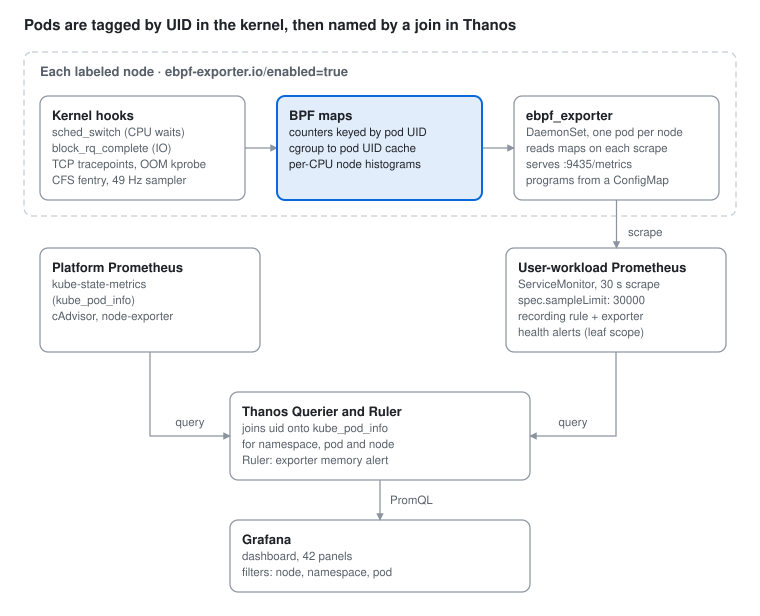

# ebpf-pod-metrics — Design & Operations Guide

Last updated 2026-10-26. Design, deployment and operations guide for the `charts/ebpf-pod-metrics` Helm chart.

## Overview

ebpf-pod-metrics is a Helm chart that runs cloudflare/ebpf\_exporter v2.5.1 as a DaemonSet with six custom eBPF programs and ships a Grafana dashboard, so each OpenShift node reports per-pod kernel signals that cAdvisor and node-exporter cannot see. It is sized and tested for OpenShift 4.16 at 28 nodes and 8,000 pods.

The questions it answers:

| Question | Signal | Source |
| --- | --- | --- |
| Is a pod waiting for CPU even though it is under its limit? | Run-queue latency per pod and per node | `pod-runqlat` |
| How long does each CFS throttle stall freeze a pod? | Throttle stall duration | `pod-cfs-throttling` |
| Which pods retransmit or get reset on TCP? | Retransmits, RSTs sent and received | `pod-tcp` |
| Which pods suffer slow disk IO, including writeback? | Block read/write latency | `pod-bio-latency` |
| What got OOM-killed, and which process? | OOM kills with victim name | `pod-oomkill` |
| What uses node CPU that is not a pod (kubelet, CRI-O, OVS, kworker, SLUB)? | 49 Hz CPU sampling by owner and kernel function | `node-cpu-profile` |

The dashboard puts these next to the standard node view (CPU utilization, load per core, CPU modes, requested vs allocatable) so an operator can tell real saturation from contention. Every per-pod series carries the pod UID and joins onto `kube_pod_info`, so all panels filter by node, namespace and pod.

Deployment is opt-in per node: nothing runs until a node is labeled `ebpf-exporter.io/enabled=true`, and removing the label detaches every program immediately.

## Architecture

The BPF programs attach to kernel tracepoints and keep counters in BPF maps; ebpf\_exporter reads the maps on each scrape and serves them on port 9435. User-workload Prometheus scrapes it, Thanos Querier joins it with platform metrics, and Grafana reads from Thanos.



The kernel only ever sees cgroups; the pod UID is the bridge, and Thanos turns it into namespace, pod and node names at query time.

### In-kernel pod attribution

Each program resolves the cgroup of the thing it observes (the running task, the socket, the bio, the CFS run queue) to a pod UID inside the kernel:

1. Walk up the cgroup tree, at most 6 levels, until a directory named `kubepods-pod<uid>.slice`, `kubepods-burstable-pod<uid>.slice` or `kubepods-besteffort-pod<uid>.slice` is found.
2. Convert systemd's escaped `_` back to `-`, so the label equals the API object's `uid`.
3. Cache the result per cgroup id (including "not a pod"), so the hot path is one hash lookup.

Consequences:

- The `uid` label joins directly onto `kube_pod_info{uid}`; Grafana adds namespace, pod and node from there.
- Data survives container restarts, because it is keyed by pod, not container.
- Non-pod cgroups (`system.slice`, kernel threads) are dropped in the kernel, except by `node-cpu-profile`, which reports them by name.
- No host mounts, no `hostPID` and no userspace cgroup path decoding are needed.

On cgroup v1 nodes, tasks resolve through their cpu-controller cgroup first, then the v2 tree. CFS and block IO resolve through their own controller's cgroup. TCP attribution uses the socket's cgroup, which only exists on cgroup v2.

### Per-pod vs per-node histograms

Histograms are split for scale. Per pod: two thresholds plus sum and count (6 series per pod per histogram), enough for "share of waits over 1 ms / 10 ms" and averages. Per node: the full exp2 distribution (1 µs to 4.2 s, 23 buckets) over every task or request on the node, kept once per node in per-CPU arrays.

## Programs and metrics

Six programs, each independent: disabling one in values removes its hooks, its series and its panels' data, and the others keep working. All metric names carry the `ebpf_exporter_` prefix.

### Programs

| Program | Kernel hook | Fires on | Measured cost | How it measures |
| --- | --- | --- | --- | --- |
| `pod-runqlat` | `tp_btf/sched_switch` | every context switch | 86 ns | Reads the scheduler's own `sched_info.last_queued` stamp against the run-queue clock; no wakeup hooks, no timestamp map |
| `pod-cfs-throttling` | `fentry/unthrottle_cfs_rq` | each unthrottle of a per-CPU run queue | rare | `rq->clock - cfs_rq->throttled_clock` |
| `pod-tcp` | `tp_btf/tcp_retransmit_skb`, `tcp_send_reset`, `tcp_receive_reset` | retransmits and RSTs | rare | Counts by the socket's cgroup, so timer and softirq retransmits land on the owning pod |
| `pod-bio-latency` | `tp_btf/block_rq_complete` | every block IO | 319 ns | `now - rq->start_time_ns` (the basis of iostat await); cgroup from the still-attached bio |
| `pod-oomkill` | `kprobe/oom_kill_process` | each OOM kill | rare | Victim task's pod and `comm` |
| `node-cpu-profile` | `perf_event` CPU clock, 49 Hz per CPU | 49 times a second per CPU | ~4.5 µs per sample, ~0.02% of each CPU | Classifies the running task; kernel-mode samples record the instruction pointer |

Costs are averages from `kernel.bpf_stats_enabled=1` on a 6.18 kernel VM with JIT on; see Safety and overhead.

### Metrics

| Metric | Type | Labels | Buckets |
| --- | --- | --- | --- |
| `pod_runqueue_latency_seconds` | histogram | `uid` | 1 ms, 10 ms, +Inf |
| `node_runqueue_latency_seconds` | histogram | — | exp2, 1 µs to 4.2 s |
| `pod_cfs_throttled_seconds` | histogram | `uid` | 10 ms, 80 ms, +Inf |
| `node_cfs_throttled_seconds` | histogram | — | exp2, 1 µs to 4.2 s |
| `pod_tcp_retransmits_total` | counter | `uid` |  |
| `pod_tcp_resets_sent_total` | counter | `uid` |  |
| `pod_tcp_resets_received_total` | counter | `uid` |  |
| `pod_block_io_latency_seconds` | histogram | `uid`, `operation` (read, write) | 1 ms, 10 ms, +Inf |
| `node_block_io_read_latency_seconds` | histogram | — | exp2, 1 µs to 4.2 s |
| `node_block_io_write_latency_seconds` | histogram | — | exp2, 1 µs to 4.2 s |
| `pod_oom_kills_total` | counter | `uid`, `comm` |  |
| `node_cpu_samples_total` | counter | `context` (pod, system, kernel, idle), `name`, `mode` (user, kernel) |  |
| `node_kernel_function_samples_total` | counter | `function`, `context` |  |
| `node_kernel_function_samples_dropped_total` | counter | — |  |

Prometheus adds `node` (from the pod's node name) and `job="ebpf-exporter"` at scrape time. The CFS thresholds are 10 ms and 80 ms because they render exactly as `le="0.01"` and `le="0.08"`; 50 ms would print as `0.049999999999999996` and break exact-match queries.

### Reading the CPU-sample metrics

`rate(node_cpu_samples_total[5m]) / 49` is CPU cores. `context` says who was running:

- `pod`: a task in a pod cgroup.
- `system`: a non-pod cgroup, named by its leaf (`kubelet.service`, `crio.service`, `ovs-vswitchd.service`; `session-N.scope` is folded to `session.scope`).
- `kernel`: a kernel thread, with per-CPU suffixes folded (`kworker/3:1H` to `kworker`, `kswapd0` to `kswapd`, `irq/125-mlx5_comp3` to `irq/mlx5_comp`).
- `idle`: the idle task; kernel functions under `idle` are interrupts and softirqs landing on an idle CPU.

Interrupt and softirq time on a busy CPU is charged to whatever was running there.

## Dashboard guide

The dashboard "Nodes & Pods — CPU and eBPF kernel metrics" (uid `ebpf-pod-metrics`, 42 panels) reads from one Prometheus data source that must see both the exporter metrics and `kube_pod_info`: use Thanos Querier, not a single Prometheus.

### Variables

| Variable | Values | Effect |
| --- | --- | --- |
| Data source | Prometheus data sources | Thanos Querier |
| Node | nodes from `kube_pod_info` | Filters every node and pod panel |
| Namespace | namespaces on the selected nodes | Filters pod panels |
| Pod | pods in the selected namespaces | Filters pod panels |
| Kernel context | pod, system, kernel, idle | Filters the kernel-function panels |
| Top N | 5, 10, 20, 50 | Series shown in top-N panels |

### Sections

| Section | Panels | Use it to |
| --- | --- | --- |
| Overview | Pods observed, nodes reporting, programs detached, worst pod CPU waits > 10 ms, TCP retransmits/s, OOM kills | Spot-check health and the worst offender at a glance |
| Node CPU | Per-node table (CPU util, load1/load15 per core, CPU requested, pods' threads waiting, run-queue p99, cores); CPU util and load per core over time; CPU time by mode; pods' threads waiting per node; per-pod table of top 50 CPU users and top 50 waiters | Tell saturation from contention, and find who drives a node vs who suffers on it |
| Node CPU — who is using it | CPU by owner (pods, node services, kernel threads, interrupts on idle CPUs); top non-pod consumers; non-pod table split user/kernel; kernel CPU by subsystem; top kernel functions | Find CPU that no pod is charged for, down to SLUB, memcg, reclaim or locks |
| CPU scheduling | Share of waits > 1 ms per pod; average threads waiting per pod; node run-queue heatmap; run-queue p99 per node; CFS throttled time; share of throttle stalls > 10 ms | Find noisy neighbours and pods capped by their own CPU limit |
| Network (TCP) | Retransmits/s, RSTs sent/s, RSTs received/s per pod | Find lossy paths, aborting clients and restarting dependencies |
| Block IO | Share of IOs > 10 ms per pod and op; IOPS; average latency; node read/write p99 | Separate a noisy pod from a slow device or backend |
| Memory | OOM kills in range, by victim process; OOM kills over time | See OOM kills that don't restart the container (sidecars, child processes) |
| Exporter health (collapsed) | Attached programs per node (expect 8); eBPF CPU cost by program; exporter RSS; dropped kernel-function samples | Verify the exporter itself |

### How to read it

- **Saturation vs contention.** High CPU utilization with high run-queue waits is saturation: add capacity or move pods. Moderate utilization with high waits is contention on a few cores: CPU pinning, IRQ affinity, or CFS bandwidth limits.
- **Load is not CPU.** Linux load counts uninterruptible (IO) sleep. High load per core with low run-queue waits usually means tasks blocked on storage, not CPU.
- **Who drives, who suffers.** In the per-pod table, CPU used above request marks the drivers; high threads waiting or waits > 1 ms with modest usage marks the victims. Throttled pods are capped by their own limit, not by the node.
- **Non-pod CPU.** Kernel-mode time on a service (e.g. `crio.service`) is syscall, IO or allocation overhead it triggers. "Slab (SLUB)" and "memcg charging" in the subsystem panel are allocator and memory-accounting cost; RCU slab freeing shows up under `ksoftirqd`.
- **Block IO.** A node-wide p99 jump that no single pod shows usually means the device or storage backend, not a noisy pod.
- **Per-pod quantiles.** Per-pod histograms have two thresholds only, so read them as shares ("8% of waits exceeded 1 ms"), not exact percentiles. Full percentiles are per node.

## Requirements and compatibility

The chart targets OpenShift 4.14 or later (`kubeVersion >=1.27`) and is built and tested for 4.16, whose RHCOS (RHEL 9.4, kernel `5.14.0-427.*`) has BTF enabled, so the CO-RE objects load without per-kernel builds.

| Requirement | Detail | How to check |
| --- | --- | --- |
| OpenShift | 4.14+; 4.16.27 is the target | `oc version` |
| Kernel BTF | `/sys/kernel/btf/vmlinux` present (default on RHCOS) | `oc debug node/<node> -- chroot /host ls /sys/kernel/btf/vmlinux` |
| cgroup mode | v2 for all metrics; v1 works except TCP. New 4.14+ installs default to v2; clusters upgraded from 4.13 or earlier usually stay on v1 | `oc debug node/<node> -- chroot /host stat -fc %T /sys/fs/cgroup` (`cgroup2fs` = v2, `tmpfs` = v1) |
| cgroup driver | systemd (OpenShift default) | pod slices named `kubepods-*-pod<uid>.slice` |
| User-workload monitoring | `enableUserWorkload: true` in `cluster-monitoring-config` | `oc -n openshift-user-workload-monitoring get pods` |
| Image | `ghcr.io/team-redbull/ebpf-pod-metrics:vX.Y.Z`, built by CI (see Supply chain); loaded into an internal registry for air-gapped clusters (see Air-gapped installation) | `skopeo inspect docker://<registry>/team-redbull/ebpf-pod-metrics:vX.Y.Z` |
| Helm | v3 (rendering tested with v3.16.4); ArgoCD with OpenShift GitOps also works | `helm version` |
| Namespace | Exists before install, privileged PSA labels | see Installation |
| RBAC for the installer | Create a cluster-scoped SCC and ClusterRole (or reuse an existing SCC) | `oc auth can-i create securitycontextconstraints` |

### Kernel-specific behavior on 4.16

- The code covers both layouts that changed around 5.14: `task_struct::__state`, the single-argument `block_rq_issue`, and both `sock_cgroup_data` layouts.
- Kernel 5.14 has no fanotify support for cgroupfs, so the exporter uses its cgroup walker whatever its capabilities. Withholding `CAP_DAC_READ_SEARCH` only matters on kernels 6.6 and later (RHEL 10-based RHCOS); see Security posture.
- `openshift.io/required-scc`, which pins the pod to its SCC, is honored from 4.14.

## Installation

Install with Helm into an existing, privileged-labeled namespace; nothing runs until nodes are labeled. The chart does not create its namespace, because Helm stores its release Secret there and the namespace must exist first.

### Helm

1. Air-gapped: load the image into the internal registry first (see Air-gapped installation below).

2. Create and label the namespace:

```bash
oc create namespace ebpf-exporter
oc label namespace ebpf-exporter --overwrite \
  pod-security.kubernetes.io/enforce=privileged \
  pod-security.kubernetes.io/audit=privileged \
  pod-security.kubernetes.io/warn=privileged \
  security.openshift.io/scc.podSecurityLabelSync=false
```

3. Install:

```bash
helm install ebpf-exporter charts/ebpf-pod-metrics -n ebpf-exporter \
  --set image.registry=registry.internal:5000
```

4. Follow the install notes: they print the pre-flight, canary and kill-switch commands for the enabled programs. Continue with the Rollout runbook.

### ArgoCD (OpenShift GitOps)

One Application per cluster, from the ArgoCD that manages that cluster (for hosted clusters, the MCE's ArgoCD). ArgoCD renders the chart with `helm template` and creates the namespace with its labels:

```yaml
apiVersion: argoproj.io/v1alpha1
kind: Application
metadata:
  name: ebpf-pod-metrics
  namespace: openshift-gitops
spec:
  project: default
  source:
    repoURL: https://git.internal/platform/ebpf-pod-metrics.git
    targetRevision: main
    path: charts/ebpf-pod-metrics
    helm:
      valuesObject:
        image:
          registry: registry.internal:5000
  destination:
    server: https://kubernetes.default.svc   # or the target cluster's API
    namespace: ebpf-exporter
  syncPolicy:
    automated: { prune: true, selfHeal: true }
    syncOptions: [CreateNamespace=true]
    managedNamespaceMetadata:
      labels:
        pod-security.kubernetes.io/enforce: privileged
        pod-security.kubernetes.io/audit: privileged
        pod-security.kubernetes.io/warn: privileged
        security.openshift.io/scc.podSecurityLabelSync: "false"
```

- The application controller needs RBAC to create the cluster-scoped SecurityContextConstraints and ClusterRole. If it doesn't have it, set `scc.create=false` and `scc.name` to an SCC the platform team manages.
- The programs ConfigMap is about 600 KiB. Client-side apply copies an object into the `kubectl.kubernetes.io/last-applied-configuration` annotation, which is capped at 256 KiB, so the apply fails. The ConfigMap carries `argocd.argoproj.io/sync-options: ServerSideApply=true`, so ArgoCD applies it server-side. `helm install` doesn't use that annotation and is unaffected.
- Rendering by hand: `helm template ... | oc apply --server-side -f -`.

### Air-gapped installation (no oc mirror)

The exporter image is the only artifact fetched from the internet; the BPF objects, exporter configs and dashboard are inside the chart. Instead of `oc mirror` / `oc image mirror`, two scripts move everything as one file using skopeo, podman or docker, whichever is installed (force one with `TOOL=skopeo|podman|docker`).

On a connected host (needs helm and one of the image tools, logged in to `ghcr.io` with a token that has `read:packages`, since the CI image is private):

```bash
tools/airgap-bundle.sh            # writes dist/ebpf-pod-metrics-airgap-0.1.0.tar (~55 MB)
```

| Bundle file | Contents |
| --- | --- |
| `images/ebpf-pod-metrics-vX.Y.Z.tar` | The image as a docker-archive, one platform (`PLATFORM=linux/amd64` by default; `linux/arm64` for Arm nodes) |
| `images.txt` | Source reference, archive, platform and upstream digest |
| `charts/ebpf-pod-metrics-0.1.0.tgz` | `helm package` of the chart |
| `src/ebpf-pod-metrics-0.1.0.tar.gz` | `git archive` of HEAD, to seed an internal git server for ArgoCD |
| `airgap-load.sh` | The loader |
| `SHA256SUMS` | Checksums of all of the above |

Carry the tar across the gap. On the disconnected side, log in to the registry (`skopeo login`, `podman login` or `docker login`; `helm registry login` for the chart), then:

```bash
tar xf ebpf-pod-metrics-airgap-0.1.0.tar && cd ebpf-pod-metrics-airgap-0.1.0
./airgap-load.sh registry.internal:5000                                  # image only
./airgap-load.sh registry.internal:5000 oci://registry.internal:5000/charts   # image + chart
```

The loader:

1. Verifies `SHA256SUMS` and stops on any mismatch.
2. Pushes the image to `<registry>/team-redbull/ebpf-pod-metrics:vX.Y.Z` (its upstream path under your registry). The registry argument may carry a path prefix, e.g. `registry.internal:5000/mirror`.
3. Optionally runs `helm push` for the chart.
4. Writes `values-airgap.yaml` with `image.registry`, `image.repository` and the `image.digest` the internal registry reports. The digest is read back after the push, because a re-push can change the manifest format and therefore the digest.

For a registry with a self-signed certificate, set `TLS_VERIFY=false` (skopeo, podman, helm). Docker needs the registry in `insecure-registries` in `daemon.json` instead.

Then install with `-f values-airgap.yaml`, from the packaged chart or the OCI registry:

```bash
helm install ebpf-exporter charts/ebpf-pod-metrics-0.1.0.tgz -n ebpf-exporter -f values-airgap.yaml
helm install ebpf-exporter oci://registry.internal:5000/charts/ebpf-pod-metrics --version 0.1.0 \
  -n ebpf-exporter -f values-airgap.yaml
```

For ArgoCD, push `src/ebpf-pod-metrics-0.1.0.tar.gz` to the internal git server and copy the `image` block of `values-airgap.yaml` into the Application's `valuesObject`.

Cluster pull access: if the internal registry needs credentials, add them to the cluster's global pull secret or set `imagePullSecrets`. If its CA isn't trusted by the nodes, add it to `image.config.openshift.io/cluster` (`additionalTrustedCA`).

### Verify

- `oc -n ebpf-exporter logs ds/ebpf-exporter` ends with `Started with 6 programs`.
- `ebpf_exporter_ebpf_program_attached` is 1 for all 8 programs on every labeled node.
- The ServiceMonitor target is up in the user-workload Prometheus, and the dashboard's "Nodes reporting" equals the labeled node count.

## Configuration reference

Every value with its default. `values.schema.json` rejects unknown keys, unknown program names and wrong types at render time, so a typo fails the install instead of deploying something broken.

| Value | Default | Effect |
| --- | --- | --- |
| `fullnameOverride` | `ebpf-exporter` | Name of every resource, including the cluster-scoped SCC and ClusterRole. Empty = `<release>-ebpf-pod-metrics` |
| `nameOverride` | `""` | Overrides the chart name in labels |
| `image.registry` | `""` | Replaces the registry in `image.repository`; set to the internal mirror |
| `image.repository` | `ghcr.io/team-redbull/ebpf-pod-metrics` | Rewritten by CI on main |
| `image.tag` | `vX.Y.Z` | Rewritten by CI on main |
| `image.digest` | `""` | `sha256:…`; takes precedence over the tag |
| `image.pullPolicy` | `IfNotPresent` |  |
| `imagePullSecrets` | `[]` |  |
| `programs.pod-runqlat.enabled` | `true` | Per-pod CPU waits + node run-queue distribution |
| `programs.pod-cfs-throttling.enabled` | `true` | Throttle stall durations |
| `programs.pod-tcp.enabled` | `true` | Retransmits and RSTs (cgroup v2 only) |
| `programs.pod-bio-latency.enabled` | `true` | Per-pod + node block IO latency |
| `programs.pod-oomkill.enabled` | `true` | OOM kills with victim name |
| `programs.node-cpu-profile.enabled` | `true` | Non-pod CPU and kernel functions; adds `CAP_SYSLOG` and keeps it after attach |
| `nodeSelector` | `kubernetes.io/os: linux`, `ebpf-exporter.io/enabled: "true"` | Per-node opt-in |
| `tolerations` | `[{operator: Exists}]` | Runs on every labeled node, including masters, infra and GPU |
| `affinity` | `{}` |  |
| `priorityClassName` | `""` | Keep empty: a high priority would let the DaemonSet preempt workload pods |
| `updateStrategy` | RollingUpdate, `maxUnavailable: 10%` |  |
| `podAnnotations`, `podLabels` | `{}` |  |
| `resources.requests` | `cpu: 50m`, `memory: 128Mi` |  |
| `resources.limits` | `cpu: 500m`, `memory: 256Mi` | BPF map memory counts against this limit |
| `extraArgs` | `[]` | Extra ebpf\_exporter flags, each starting `--` (e.g. `--debug`) |
| `service.port` | `9435` | Metrics port |
| `scc.create` | `true` | Create the least-privilege SCC |
| `scc.name` | `""` | Existing SCC to use when `scc.create=false` (required then) |
| `serviceMonitor.enabled` | `true` | Needs user-workload monitoring |
| `serviceMonitor.interval` | `30s` | Disk and memory scale linearly with it |
| `serviceMonitor.scrapeTimeout` | `10s` |  |
| `serviceMonitor.sampleLimit` | `30000` | Per-node scrape guard (`spec.sampleLimit`) |
| `serviceMonitor.dropKernelFunctions` | `false` | Drops `node_kernel_function_samples_total` (a third of all series) and its recording rule |
| `serviceMonitor.metricRelabelings` | `[]` | Extra relabelings, appended after the drop rule |
| `serviceMonitor.labels` | `{}` |  |
| `prometheusRule.enabled` | `true` |  |
| `prometheusRule.labels` | `{}` |  |
| `prometheusRule.recordingRules` | `true` | Kernel-subsystem recording rule (only with `node-cpu-profile` and kernel functions kept) |
| `prometheusRule.alerts.enabled` | `true` |  |
| `prometheusRule.alerts.overheadCores` | `0.05` | `EbpfExporterHighOverhead` threshold, cores per node |
| `prometheusRule.alerts.memoryLimitRatio` | `0.85` | `EbpfExporterNearMemoryLimit` threshold |
| `dashboard.configMap.enabled` | `false` | ConfigMap for a Grafana sidecar |
| `dashboard.configMap.namespace` | release namespace |  |
| `dashboard.configMap.labels` | `grafana_dashboard: "1"` | Sidecar selector label |
| `dashboard.configMap.annotations` | `{}` | e.g. a sidecar folder annotation |
| `dashboard.grafanaOperator.enabled` | `false` | `GrafanaDashboard` CR for grafana-operator v5 |
| `dashboard.grafanaOperator.namespace` | release namespace |  |
| `dashboard.grafanaOperator.instanceSelector` | `matchLabels: {dashboards: grafana}` | Which Grafana instances import it |
| `dashboard.grafanaOperator.folder` | `""` |  |
| `dashboard.grafanaOperator.allowCrossNamespaceImport` | `false` |  |
| `dashboard.grafanaOperator.resyncPeriod` | `10m` |  |

### Behavior that follows from values

- **Capabilities follow programs.** Without `node-cpu-profile`, the SCC and container drop `SYSLOG` and the exporter keeps no capability after attaching (`--capabilities.keep=none`).
- **The programs ConfigMap is content-addressed.** Its name ends in a hash of the enabled objects and configs, so enabling, disabling or rebuilding a program renames it and rolls the DaemonSet; the ConfigMap is immutable.
- **The Prometheus job is fixed.** The ServiceMonitor takes the job name from a Service label, so `job="ebpf-exporter"` holds whatever the release name; the dashboard and alerts rely on it.

## Rollout runbook

Roll out in four steps: verify the kernel accepts the programs, run one canary node for 24 hours with BPF stats on, then widen in waves, with HyperShift control-plane hosts last.

1. **Pre-flight the verifier on one node.** Label one non-critical worker, then load and attach every program once and exit:

```bash
oc label node <node> ebpf-exporter.io/enabled=true
oc -n ebpf-exporter debug ds/ebpf-exporter -- /ebpf_exporter \
  --config.dir=/etc/ebpf-pod-metrics \
  --config.names=node-cpu-profile,pod-bio-latency,pod-cfs-throttling,pod-oomkill,pod-runqlat,pod-tcp \
  --config.check --config.strict
```

Success ends with `Config check successful`. A failure names the program; disable it in values (`programs.<name>.enabled=false`) and continue with the rest.

2. **Canary for 24 hours.** Turn on per-program cost accounting on that node (not persistent; a reboot resets it):

```bash
oc debug node/<node> -- chroot /host sysctl -w kernel.bpf_stats_enabled=1
```

Watch: Exporter health → "eBPF CPU cost by program" (the real per-hook cost on your hardware), `EbpfExporterHighOverhead` (fires above 0.05 cores per node), exporter memory, and the p99 latency of the workloads on the canary against a similar neighbor. Then turn stats off (`sysctl -w kernel.bpf_stats_enabled=0`); the accounting itself costs about 20 ns per program run.

3. **Widen in waves.** One NodePool or MachineConfigPool at a time:

```bash
oc label node -l <pool selector> ebpf-exporter.io/enabled=true
```

Management-cluster nodes that host HyperShift control planes (kube-apiserver, etcd) go last.

4. **Tune instead of all-or-nothing.** If one program costs too much on your hardware, disable only that one. `pod-runqlat` is the only hook on every context switch; `node-cpu-profile` is the only sampler.

### Kill switch

| Scope | Command | Effect |
| --- | --- | --- |
| One node | `oc label node <node> ebpf-exporter.io/enabled-` | Pod exits; its programs detach immediately |
| One program, all nodes | `helm upgrade … --set programs.<name>.enabled=false` | DaemonSet rolls without that program |
| Everything | `helm -n ebpf-exporter uninstall ebpf-exporter`, or delete the ArgoCD Application | All programs detach as pods exit |

Nothing persists after the pod exits: programs are not pinned, so the kernel unloads them with the process. In testing, the system-wide BPF program count went from 7 to 0 immediately after `kill -9`.

## Safety and overhead

The programs only observe, the kernel verifies them before loading, and the measured worst case is 86 ns per context switch: about 0.8% of one core at 100,000 switches per second, or 0.01% of a 64-core node.

### What the programs can and cannot do

- **Read-only tracing.** Only tracepoint, fentry and kprobe hooks plus a 49 Hz perf sampler. No XDP or tc (nothing in the OVN datapath), no LSM, no `override_return`, no `probe_write_user`: they cannot drop packets, change scheduling, block syscalls or modify memory.
- **Verifier-bounded.** The kernel proves each program terminates and reads memory safely before loading it. If the RHCOS verifier rejects one, the exporter fails to start and the node is untouched.
- **No allocation on hot paths.** Maps are preallocated; nothing allocates under the run-queue lock.
- **Nothing persists.** Programs are not pinned and live only as long as the exporter process.

### Measured cost

Exporter v2.5.1, 6.18 kernel VM, JIT on, `kernel.bpf_stats_enabled=1`:

| Hook | Fires on | First version | Shipped |
| --- | --- | --- | --- |
| `pod-runqlat` | every context switch | 421 ns + 111 ns per wakeup | 86 ns, no wakeup hook |
| `pod-bio-latency` | every block IO | ~1.35 µs (two hooks + start map) | 319 ns (one hook) |
| `node-cpu-profile` | 49 times a second per CPU | ~4.5 µs | ~4.5 µs (~0.02% of each CPU) |
| TCP, OOM, CFS hooks | retransmits, RSTs, OOM kills, throttle events | rare | rare |

A worst-case A/B benchmark (two processes passing a byte back and forth, forcing a context switch every hop; no real workload is this switch-bound) measured +7% round-trip time on one CPU and +2.6% across CPUs, inside run-to-run noise. The first version measured +33%.

What made the difference: `pod-runqlat` reads the scheduler's own `sched_info.last_queued` stamp (the accounting behind `/proc/<pid>/schedstat`) instead of hooking wakeups and keeping a timestamp map; block IO reads `rq->start_time_ns` and the still-attached bio at completion; both use direct BTF loads instead of `bpf_probe_read` and per-CPU counters.

### Memory

About 13 MiB of BPF maps plus about 0.1 MiB per CPU (about 25 MiB on a 128-CPU node), sized for 1,024 pods per node. Map memory is charged to the exporter's own cgroup on RHEL 9, so the 256 Mi limit bounds it: if it cannot fit, the exporter fails to start instead of consuming node memory. The pod is Burstable, so under memory pressure it is evicted before Guaranteed workloads.

### Scheduling and the API server

- **No priority class.** A high-priority DaemonSet pod would preempt (evict) workload pods on a full node; at priority 0 it stays Pending.
- **Zero API calls.** `automountServiceAccountToken: false`: the exporter has no token and never talks to the API server.
- **Immutable ConfigMap.** Kubelets don't keep a watch on it.
- **Prometheus guard.** `spec.sampleLimit: 30000` per node (about 7,500 samples at 286 pods per node, 13,000 at 500). A runaway node fails its scrape and fires `EbpfExporterDown` instead of flooding the TSDB.
- **CPU limit 500m** bounds the exporter process (scrape decoding). In-kernel BPF time is charged to the traced tasks, which is why it is measured separately.

### Residual risk

- These numbers come from a VM on a 6.18 kernel. RHEL 9.4 on bare metal will differ; the canary with `bpf_stats_enabled` gives the real figures.
- The eBPF subsystem itself can have kernel bugs. The hooks used are the same ones Red Hat's supported `bcc-tools` and `bpftrace` use on RHEL 9.
- Red Hat support may ask to remove third-party privileged agents while working a node-level case.

## Capacity planning

At 28 nodes and 8,000 pods the exporter adds about 209,000 active series and 3–4 GB of disk per Prometheus replica at the default 24-hour retention. Dropping kernel functions cuts both by about a third.

### Series

Measured against a synthetic cluster of that exact shape: 28 exporter targets serving this chart's series layout (about 286 pods per node; 30% throttled, 70% doing block IO, 20% with TCP events; about 1,500 distinct kernel functions per node), scraped by Prometheus 3.5.

| Source | Series |
| --- | --- |
| Per-pod metrics (8,000 pods, about 17 per pod on average, at most 33) | ~134,000 |
| Per-node histograms, CPU owners, exporter self-metrics (28 nodes) | ~5,000 |
| `node_kernel_function_samples_total` (function × context, 28 nodes) | ~70,000 |
| **Total** | **~209,000** |

The first layout (12 fine buckets per pod per histogram) would have produced about 63 series per pod, about 500,000 for the pods alone. One exporter scrape is about 7,500 samples at 286 pods per node.

### Disk and memory

Measured from real TSDB blocks built with `promtool` from two hours of data in this layout: 3.6 bytes per sample with aligned scrapes, 5.3 with ±4 ms scrape jitter; the write-ahead log costs about 6.3 bytes per sample. At a 30 s interval, 209,000 series are about 25 million samples an hour.

| Per Prometheus replica | All series (~209k) | Without kernel functions (~139k) |
| --- | --- | --- |
| Blocks per day of retention | 2.2–3.2 GB | 1.4–2.1 GB |
| WAL and head (always kept) | ~0.65 GB | ~0.45 GB |
| Total at 24 h retention (UWM default) | ~3–4 GB | ~2–2.7 GB |
| Total at 7 days | ~18–25 GB | ~12–17 GB |
| Total at 15 days | ~38–53 GB | ~25–35 GB |

User-workload monitoring runs two Prometheus replicas, so double these for the cluster. For the default retention, a 10 GiB PVC per replica leaves room for compaction; with `retentionSize`, keep it about 2 GB under the PVC size, because WAL and head count toward the limit but are never purged by it. In the scale test, Prometheus held all ~263,000 series of the synthetic cluster in about 540 MiB RSS shortly after start; steady state with retention will be higher.

### Reduction levers, biggest first

1. `serviceMonitor.dropKernelFunctions=true`: about −70,000 series. The "Top kernel functions" and "Kernel CPU by subsystem" panels go empty; "Node CPU by owner" and "Top non-pod CPU consumers" keep working.
2. Drop per-pod block IO, keep the node histograms: about −65,000 series.

```yaml
serviceMonitor:
  metricRelabelings:
    - sourceLabels: [__name__]
      regex: ebpf_exporter_pod_block_io_latency_seconds.*
      action: drop
```

3. `programs.pod-cfs-throttling.enabled=false`.
4. `serviceMonitor.interval=60s`: halves samples, disk and WAL for every series.

## Security posture

The pod is not privileged and has no host access: it gets only the capabilities its programs need, the `spc_t` SELinux type, and drops every capability except `SYSLOG` once the programs are attached.

| Control | Setting | Why |
| --- | --- | --- |
| SCC | Custom, one per release, bound only to the chart's ServiceAccount; pinned with `openshift.io/required-scc` | Least privilege; no other pod can use it |
| Privileged | `false` | Not needed for BPF tracing |
| Host access | No host paths, hostPID, hostNetwork, hostIPC or host ports; volumes limited to configMap, projected, emptyDir | Pod attribution happens in the kernel |
| Capabilities added | `BPF`, `PERFMON`, `SYS_RESOURCE`, plus `SYSLOG` with `node-cpu-profile`; all others dropped | `BPF` loads programs and reads kernel memory; `PERFMON` attaches to tracepoints and kprobes; `SYS_RESOURCE` covers memlock; `SYSLOG` gives real addresses in `/proc/kallsyms` |
| After attach | `--capabilities.keep=cap_syslog` (or `none` without the profiler) | The running process holds no `BPF`/`PERFMON`; `SYSLOG` stays so kernel-function names can be re-resolved when modules load |
| SELinux | `spc_t` | `container_t` is denied the `bpf()` syscall |
| seccomp | `Unconfined` | `RuntimeDefault` blocks `bpf()` and `perf_event_open()` |
| Filesystem | Read-only root; runs as UID 0 for the capability set |  |
| API access | No service account token mounted | The exporter never calls the API server |
| Escalation | `allowPrivilegeEscalation: false` |  |

### Why not CAP\_DAC\_READ\_SEARCH

ebpf\_exporter switches its cgroup watcher to fanotify when it holds `CAP_DAC_READ_SEARCH` on kernels 6.6 or later. In v2.5.1 that watcher calls `log.Fatal` on any non-directory create event in cgroupfs, which crash-loops the exporter; this was reproduced in testing. These programs resolve pods in the kernel and never use the watcher, so the capability is withheld. On RHCOS 4.16 (kernel 5.14) fanotify is unavailable for cgroupfs anyway; this protects a future move to a 6.6+ kernel.

### Supply chain

- The image is built by CI from `Dockerfile`: the upstream `ghcr.io/cloudflare/ebpf_exporter:v2.5.1`, pinned by digest, with the BPF objects and configs from `files/programs/` added at `/etc/ebpf-pod-metrics`. Nothing else is changed. It is pushed to `ghcr.io/team-redbull/ebpf-pod-metrics`; pin it by `image.digest` in production (`airgap-load.sh` does). The bundle records the upstream digest in `images.txt` and checksums every file.
- The BPF objects are built from the C sources in `bpf/` against the exporter's `vmlinux.h` and libbpf v1.5.0 headers. Builds are reproducible: three clean builds into the same path are byte-identical.

## Alerts and recording rules

The chart ships five exporter-health alerts and one recording rule, split across two PrometheusRules by where each can see its data. Pod-level alerts are not shipped (see Known limitations).

| Rule | Kind | Evaluated in | Expression (summary) | For | Severity |
| --- | --- | --- | --- | --- | --- |
| `ebpf:node_kernel_subsystem_cores:rate2m` | recording, every 1m | user-workload Prometheus (`leaf-prometheus`) | Kernel-function sample rate grouped into ~17 subsystems by function-name regexes, per node and context, in cores |  |  |
| `EbpfExporterDown` | alert | user-workload Prometheus | `up{job="ebpf-exporter"} == 0`; includes scrapes failed by `sampleLimit` | 10m | warning |
| `EbpfExporterProgramDetached` | alert | user-workload Prometheus | `ebpf_exporter_ebpf_program_attached == 0` | 10m | warning |
| `EbpfExporterHighOverhead` | alert | user-workload Prometheus | BPF run time per node > `overheadCores` (0.05); only while `kernel.bpf_stats_enabled=1` | 15m | warning |
| `EbpfExporterDecoderErrors` | alert | user-workload Prometheus | Any label decoding errors | 15m | info |
| `EbpfExporterNearMemoryLimit` | alert | Thanos Ruler | Exporter working set / memory limit > `memoryLimitRatio` (0.85) | 15m | warning |

Why the split: rules labeled `openshift.io/prometheus-rule-evaluation-scope: leaf-prometheus` run inside user-workload Prometheus, next to the exporter's own series, but cannot see platform metrics. `EbpfExporterNearMemoryLimit` needs cAdvisor and kube-state-metrics data, so it lives in a second PrometheusRule (`<name>-platform`) that Thanos Ruler evaluates, restricted to the release namespace.

Why a recording rule: grouping every kernel-function series through 17 `label_replace` regexes took about 2.2 s per dashboard load at 28 nodes; the recorded series (about 250 at 28 nodes) load in about 2 ms. The rule is skipped when `node-cpu-profile` is off or `dropKernelFunctions=true`. The regexes are generated together with the dashboard by `tools/gen_dashboard.py`, so both always agree.

## Day-2 operations

All changes go through the chart: edit values or rebuild a file in `charts/ebpf-pod-metrics/files/`, bump the chart version, and upgrade (or let ArgoCD sync). The programs ConfigMap is content-addressed, so any program change rolls the DaemonSet by itself.

### Repository layout

```
charts/ebpf-pod-metrics/      Helm chart
  values.yaml                 all knobs, commented
  values.schema.json          rejects typos and wrong types
  files/programs/             CO-RE objects (*.bpf.o) + ebpf_exporter configs (*.yaml)
  files/dashboards/           Grafana dashboard JSON
  files/rules/                kernel-subsystem recording rule expression
  templates/                  SCC, RBAC, programs ConfigMap, DaemonSet, Service,
                              ServiceMonitor, PrometheusRules, dashboard, NOTES
bpf/                          C sources + Makefile (builds into files/programs/)
tools/gen_dashboard.py        regenerates the dashboard and the recording rule
tools/airgap-bundle.sh        builds the offline bundle on a connected host
tools/airgap-load.sh          loads it into an internal registry on the disconnected side
```

### Common tasks

| Task | How |
| --- | --- |
| Change a value (mirror, limits, thresholds) | `helm upgrade ebpf-exporter charts/ebpf-pod-metrics -n ebpf-exporter --reuse-values --set …`, or edit `valuesObject` in the ArgoCD Application |
| Enable or disable a program | `--set programs.<name>.enabled=false` (or `=true`); capabilities, ConfigMap and DaemonSet follow |
| Add a node / remove a node | `oc label node <node> ebpf-exporter.io/enabled=true` / `ebpf-exporter.io/enabled-` |
| Upgrade the exporter image | Bump the `FROM` tag and digest in `Dockerfile` and push; CI builds the image and rewrites `image.tag`. Then rebuild the bundle (`tools/airgap-bundle.sh`), load it, upgrade with the new `values-airgap.yaml`, re-run the pre-flight on one node first |
| Rebuild the BPF programs | See below |
| Change dashboard panels or subsystem regexes | Edit `tools/gen_dashboard.py`, run `python3 tools/gen_dashboard.py`, upgrade |
| Ship the dashboard to Grafana | `dashboard.configMap.enabled=true` (sidecar) or `dashboard.grafanaOperator.enabled=true` (grafana-operator v5); otherwise import `files/dashboards/ebpf-pod-metrics.json` |
| Measure real BPF cost on a node | `sysctl -w kernel.bpf_stats_enabled=1` on that node, read Exporter health → "eBPF CPU cost by program", then set it back to 0 |

### Rebuilding the BPF objects

Needs clang 14 or later, `llvm-strip`, make and elfutils-libelf-devel. The objects are CO-RE, so one build runs on every RHCOS kernel with BTF.

```bash
git clone --branch v2.5.1 https://github.com/cloudflare/ebpf_exporter.git
make -C ebpf_exporter libbpf.a                 # libbpf v1.5.0 headers
make -C bpf EBPF_EXPORTER=$PWD/ebpf_exporter   # writes charts/ebpf-pod-metrics/files/programs/*.bpf.o
```

Then bump `version` in `Chart.yaml`, upgrade, and run the pre-flight check on one node before widening. A new program needs its `.bpf.c` in `bpf/`, its exporter config `<name>.yaml` in `files/programs/`, its name in the `programs` enum of `values.schema.json`, and a `programs.<name>` entry in `values.yaml`.

### Release size

The stored Helm release is about 520–540 KiB of the 1 MiB Secret limit, because it holds the chart's BPF objects and the rendered ConfigMap. Adding large files to the chart eats into that margin. ArgoCD does not create release Secrets.

## Troubleshooting

Start with the pod log and `ebpf_exporter_ebpf_program_attached`; most problems are either admission (the pod never starts) or a program the kernel rejects.

| Symptom | Likely cause | Fix |
| --- | --- | --- |
| No exporter pods at all | No node carries `ebpf-exporter.io/enabled=true` | Label a node |
| Pod `Pending` on a full node | No priority class, by design: it won't evict workloads | Free capacity on that node, or accept no coverage there |
| Pods rejected: `unable to validate against any security context constraint` | SCC missing, or the ServiceAccount isn't bound to it | Check `scc.create`, the `<name>-scc` RoleBinding, and that the pod's `openshift.io/scc` annotation names the chart's SCC |
| PodSecurity warnings or rejection | Namespace lacks privileged PSA labels | Apply the namespace labels from Installation |
| `helm install` fails: namespace not found | The chart doesn't create its namespace | Create and label it first |
| ArgoCD or `oc apply` fails: `metadata.annotations: Too long` | Client-side apply of the ~600 KiB programs ConfigMap | Use the chart's ServerSideApply annotation (ArgoCD) or `oc apply --server-side` |
| `helm template`/`install` fails: values don't meet the schema | A typo or wrong type in values | The error names the field; fix it |
| Log: `failed to load BPF object: operation not permitted` | Missing capability or seccomp/SELinux blocking `bpf()` | Check the container got `BPF`/`PERFMON` and `spc_t`, and seccomp is `Unconfined` |
| Log: `Missed attachments` or `program_attached == 0` for one program | Kernel symbol inlined or renamed on this kernel (kprobe/fentry targets: `oom_kill_process`, `unthrottle_cfs_rq`) | Disable that program; the others keep working |
| Exporter crash-loops with `Fanotify loop terminated` | `CAP_DAC_READ_SEARCH` granted on a 6.6+ kernel | Remove it; the chart never adds it |
| Pod OOMKilled or `EbpfExporterNearMemoryLimit` | BPF maps plus process exceed 256 Mi (very large CPU counts) | Raise `resources.limits.memory` or disable `node-cpu-profile` |
| `EbpfExporterDown` with the pod running | Scrape fails the per-target `sampleLimit` | Compare `scrape_samples_scraped`; raise `serviceMonitor.sampleLimit` or reduce series |
| Dashboard pod panels empty, node panels fine | Data source can't see `kube_pod_info` (pointed at user-workload Prometheus) | Use Thanos Querier |
| TCP panels empty | Node on cgroup v1 (socket cgroup is v2-only) | Expected on v1; migrate the node to cgroup v2 |
| Block IO panels empty for a pod | Pod uses NFS, CephFS or another filesystem that bypasses the block layer | Expected; node block IO histograms still cover local devices |
| Static pods (etcd, kube-apiserver on standalone control planes) missing | Their cgroup carries the static pod UID, not the mirror pod's API UID | Expected; hosted control planes are regular pods and work |
| Kernel-function panels empty | `dropKernelFunctions=true`, or `node-cpu-profile` disabled, or recording rule not yet evaluated | Check values; the rule needs 2 minutes of data |
| "eBPF CPU cost by program" empty | `kernel.bpf_stats_enabled` is 0 (default) | Enable it on the node while measuring |
| `node_kernel_function_samples_dropped_total` rising | More than 32,768 distinct instruction pointers on the node | Harmless loss of detail; restart the pod to reset the map |

### Useful commands

```bash
oc -n ebpf-exporter get ds,pods -o wide
oc -n ebpf-exporter logs ds/ebpf-exporter
oc -n ebpf-exporter get pod -l app.kubernetes.io/name=ebpf-pod-metrics \
  -o jsonpath='{range .items[*]}{.metadata.name}{"\t"}{.metadata.annotations.openshift\.io/scc}{"\n"}{end}'
oc -n ebpf-exporter port-forward pod/<exporter-pod> 9435:9435 &
curl -s localhost:9435/metrics | grep -E 'program_attached|decoder_errors'
```

The upstream image is distroless (no shell, no `curl`), so read the metrics through `oc port-forward` rather than `oc exec`.

## Known limitations

- **Static and mirror pods** (etcd, kube-apiserver on standalone control planes): the cgroup carries the static pod's UID, which differs from the mirror pod's API UID, so they don't join to `kube_pod_info`. HyperShift hosted control planes run as regular pods and are covered.
- **TCP needs cgroup v2.** The socket's cgroup exists only on v2; on v1 nodes the TCP metrics stay empty.
- **Block IO covers block devices only** (LVMS/TopoLVM, local disks, iSCSI/FC, PowerFlex SDC). NFS and CephFS don't pass the block layer. Request-based multipath can count a request at both the dm device and the path device.
- **Block IO latency includes IO-scheduler queueing**, like iostat await, because it is measured from request allocation to completion.
- **Throttle observations are per CPU.** One throttled period on a 32-CPU node can produce up to 32 observations: use the histogram for stall duration and cAdvisor's `container_cpu_cfs_throttled_periods_total` for counts.
- **Per-pod histograms are coarse:** two thresholds each, so per-pod percentiles are bucket-interpolated; full distributions exist per node only.
- **Kernel-function names** use the exporter's `kstack` decoder with one frame. The `ksym` decoder only resolves exact symbol starts and re-reads all of `/proc/kallsyms` under a global lock on every miss, which hung `/metrics` in testing.
- **Kernel-function cardinality:** one series per function and context seen on a node, from a few hundred on a quiet node to low thousands on a busy one. The address map holds 32,768 distinct addresses; overflow is counted in `node_kernel_function_samples_dropped_total`.
- **Subsystem grouping is heuristic:** function-name regexes, so some functions land in "other" and borderline names can be grouped differently than a kernel developer would.
- **Interrupt and softirq time** is charged to whatever was running on the CPU; on idle CPUs it appears under context `idle`.
- **No pod-level alerts.** They need the `kube_pod_info` join, which user-workload rules can't do across namespaces unless `ebpf-exporter` is listed in `namespacesWithoutLabelEnforcement`.
- **eBPF cost panel and overhead alert** work only while `kernel.bpf_stats_enabled=1`, which is off by default.

## Validation record

Everything below was tested in a Linux 6.18 VM with exporter v2.5.1 and Helm v3.16.4 built from its official source tag; what still needs a real OpenShift 4.16 node is listed at the end.

| Area | Test | Result |
| --- | --- | --- |
| Kernel load | `--config.check --config.strict` for `pod-runqlat`, `pod-tcp`, `pod-bio-latency`, `node-cpu-profile` | All pass the verifier and attach |
| Pod attribution | Fake Guaranteed, Burstable and BestEffort pod slices, nested `crio-*.scope/container` sub-cgroup, a `system.slice` service; on both the v1 cpu hierarchy and the v2 tree | Correct UID for every pod; `system.slice` excluded |
| Run-queue latency | 3 CPU-bound threads in one pod on 2 CPUs | Waits cluster at the ~4 ms CFS slice, as expected |
| Block IO | 3,000 direct 4 KiB writes | 3,001 counted (one metadata write) |
| TCP | Connections to a closed port from a pod | RSTs received counted on that pod |
| Non-pod CPU | CPU hog in `kubelet.service`, syscall storm in `crio.service` | Split correctly by owner; SLUB and memcg functions visible; RCU slab freeing under `ksoftirqd` |
| Overhead | Per-program `bpf_stats`; ping-pong A/B benchmark | 86 ns per switch, 319 ns per IO; +7% / +2.6% worst case |
| Teardown | `kill -9` of the exporter | System-wide BPF programs 7 → 0 immediately |
| Scale | Synthetic 28-node, 8,000-pod cluster scraped by Prometheus 3.5; every dashboard query run instant and as a 5-minute range | ~209k series; no query errors; most panels < 0.5 s, heaviest per-pod range queries 1–3.4 s on a 2-CPU box |
| Disk | TSDB blocks built with `promtool` from 2 h of data in this layout | 3.6–5.3 bytes per sample; WAL ~6.3 |
| Chart render | `helm lint`; render for Kubernetes 1.29 in 13 value combinations, each asserting its effect | All pass |
| Values schema | Typos, wrong types, bad digest, bad args, no program enabled, missing `scc.name` | Each fails with a message naming the field |
| Schemas | Strict validation (unknown field = what the API server would silently drop) against Kubernetes 1.29, Prometheus Operator v0.73.2, OpenShift 4.16 SCC and grafana-operator v5 | All objects valid in every variant |
| Binary round trip | BPF objects extracted from the rendered ConfigMap | Byte-identical to the chart files; load, attach and count correctly |
| Rules | `promtool check rules` and `promtool test rules` | `EbpfExporterDown` and `EbpfExporterNearMemoryLimit` fire with correctly rendered annotations |
| Helm release size | Encoded release vs 1 MiB Secret limit | ~520–540 KiB |

### Bugs found and fixed during validation

- The ServiceMonitor `sampleLimit` was on the endpoint instead of `spec`, so the API server would have dropped it silently; it is now `spec.sampleLimit`.
- `EbpfExporterNearMemoryLimit` was in a `leaf-prometheus` rule that cannot see cAdvisor or kube-state-metrics data, so it could never fire; it now has its own Thanos Ruler-evaluated rule.
- The programs ConfigMap exceeded the 256 KiB `last-applied-configuration` limit under client-side apply; it now carries the ArgoCD ServerSideApply annotation.
- `CAP_DAC_READ_SEARCH` crash-loops the exporter on 6.6+ kernels; it is withheld.
- The `ksym` decoder hung `/metrics` with sampled addresses; replaced by a one-frame `kstack` decoder.

### Still to verify on OpenShift 4.16

- [ ] Pre-flight `--config.check --config.strict` with all six programs on a 5.14 RHCOS node; `pod-cfs-throttling` (fentry) and `pod-oomkill` (kprobe) could not load in the test VM, which has kprobes compiled out
- [ ] Real per-program cost on bare metal with `kernel.bpf_stats_enabled=1` during the canary
- [ ] cgroup mode of each cluster (v1 nodes lose TCP metrics)
- [ ] First install through each MCE's ArgoCD, including RBAC for the SCC and ClusterRole
- [ ] User-workload Prometheus memory and PVC size against the capacity figures
